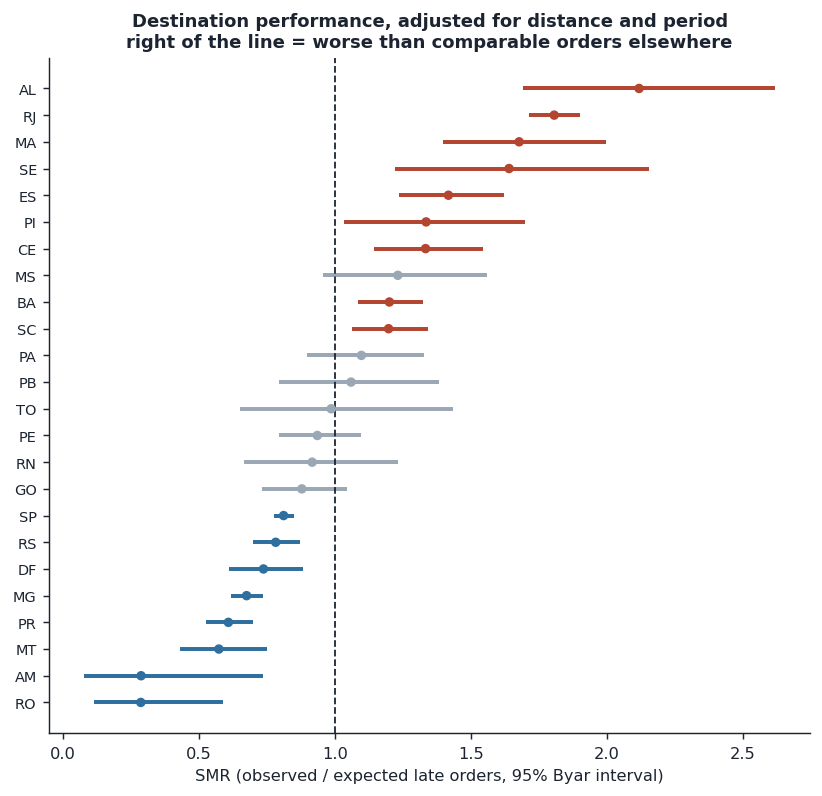
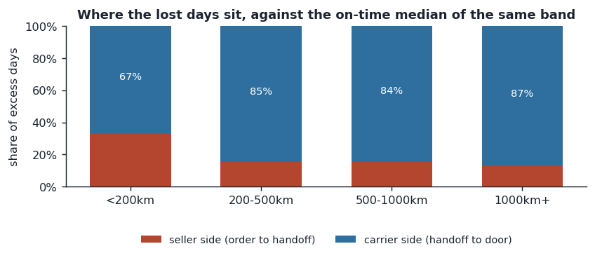
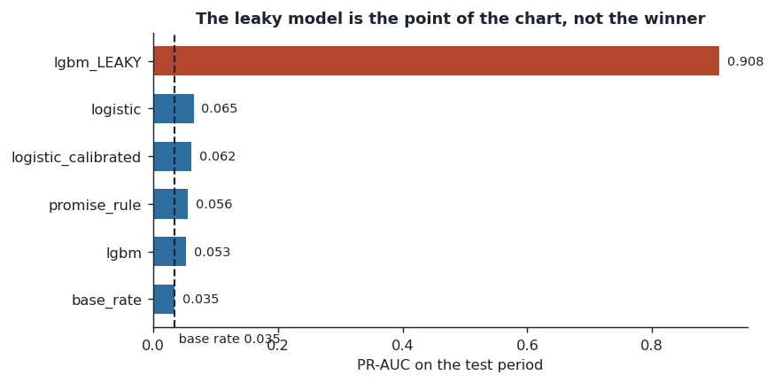
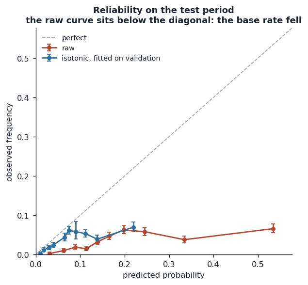
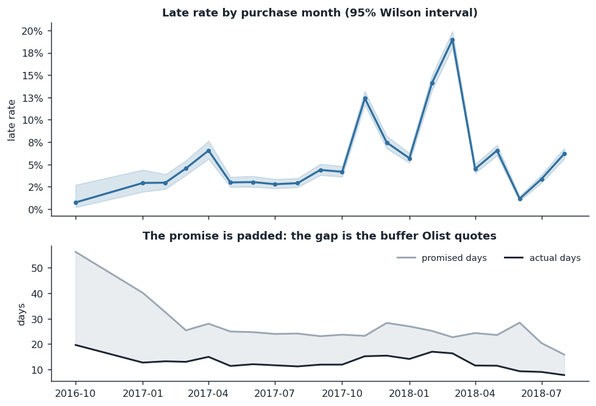
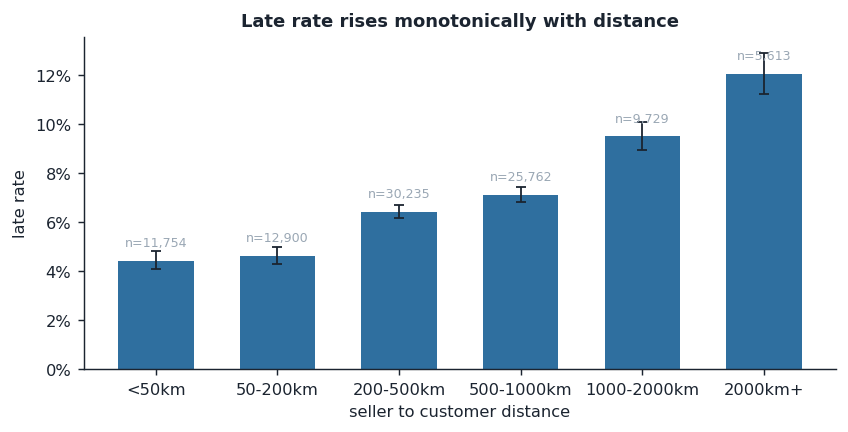
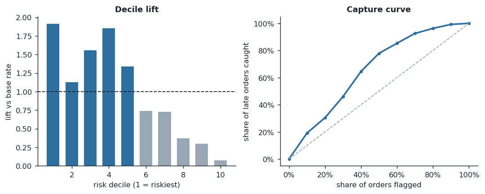
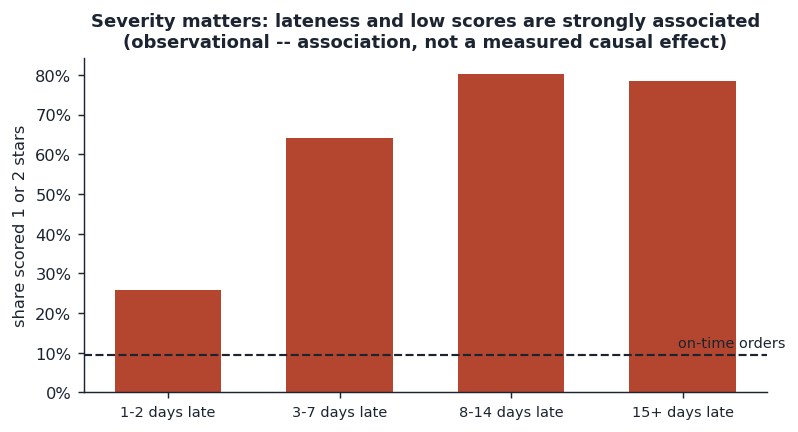

# OnTime — E-commerce Delivery-Risk & Root-Cause Analytics

[](https://github.com/BhuvanT1/ontime-delivery-risk/actions/workflows/ci.yml)
[](LICENSE)

Which orders arrive late, which parts of the network are genuinely worse than
their geography explains, and whether a risk model can be turned into an
intervention that actually pays.

Built on the public Olist dataset: **99,441 orders** loaded across nine related
tables, **96,470** delivered orders in the modelling population, **6.8%** of
them late against the date promised at checkout.

**→ [reports/DECISION_MEMO.md](reports/DECISION_MEMO.md) is the deliverable.**
The code exists to make its numbers reproducible.

---

## Headline results

| | |
|---|---|
| Rio de Janeiro, adjusted for distance and period | **1.81×** comparable orders (95% CI 1.72–1.90), **+667** excess late orders |
| 57 sellers (1.9% of the seller base) | **16.3%** of all orders at **11.5%** late vs a 6.8% baseline |
| Where the lost days sit, beyond 200 km | **85–87%** carrier-side, after the seller's handoff |
| Late orders scored 1 or 2 stars | **62.8%** (61.6–64.0) vs **9.5%** on time |
| Risk model, at-purchase features only | ROC-AUC **0.670**, PR-AUC **0.065** against a 0.035 floor |
| The same model given post-delivery fields | ROC-AUC **0.994** — this is the leak, measured |
| Isotonic calibration under a 7.9% → 3.5% base-rate shift | ECE **0.156 → 0.038** |
| Per-order intervention policy | **Below break-even.** Needs 84% effectiveness; only 4 of 27 assumption cells pay |

The last row is the point of the project. The model is real but weak; the
segment findings are large and solid. The memo recommends acting on the segments
and *not* deploying the model as a trigger.

## Figures

All eight are produced by `scripts/04_report.py`.

| | |
|---|---|
|  |  |
| **Destination states, adjusted for distance and period.** Right of the line is worse than comparable orders elsewhere; RJ's interval sits clear of 1. | **Where the lost days sit.** Beyond 200 km, 85–87% of the excess is carrier-side, after the seller's handoff. |
|  |  |
| **The model ladder on the test period.** The leaky variant is shown to measure the leak, not as a contender. | **Calibration under a falling base rate.** Isotonic, fitted on validation, pulls the curve back toward the diagonal. |
|  |  |
| **Late rate by month**, with the padded promise underneath: the base rate more than halves across the window. | **Late rate rises with distance**, from about 4% under 50 km to about 12% beyond 2,000 km. |
|  |  |
| **Lift and capture** for the champion model: real but weak, which is why the memo does not deploy it. | **Severity and reviews.** Share of 1–2 star reviews by days late; an association, not a measured causal effect. |

## What this project is careful about

**Prediction happens at checkout.** `order_fact` separates `at_*` columns —
knowable when the customer clicks buy — from `post_*` columns observed later.
Only `at_*` reaches the model. The leaky variant is fitted deliberately, and
reported, so the size of the usual self-deception is measured rather than
asserted: 0.670 against 0.994.

**A seller's history counts only what had already happened.** A previous order
tells you nothing about a seller until it has been *delivered*. The history
features use an `ASOF JOIN` on delivery date, not a `GROUP BY` on seller. On the
test fixture the naive version is strictly larger for a third of orders — that
difference is the leak, and `tests/test_sql.py` pins the behaviour.

**Splits are chronological and the test period is scored once.** The champion is
chosen on validation PR-AUC, the calibrator is fitted on validation, and the
test window is touched at the end. Picking a winner by test score is a slower
way of overfitting.

**Features are checked for range drift before fitting.** `drift_report()` flags
any feature whose test values fall outside the training range. It exists because
a raw day-counter reached the model matrix during development and cost 0.11 of
test ROC-AUC while looking healthy on validation — trees cannot extrapolate, so
every future row landed in the terminal bin.

**Rates carry intervals.** Every segment rate has a Wilson interval and every
SMR a Byar interval, because a seller with three orders and two misses tops any
unguarded ranking of late rate.

**Association is not causation, and the language says so.** Nothing was
randomised. Section 4 of the memo reports the lateness–review relationship as an
association and says what would be needed to claim more.

**Statistical method chosen for the data, not the textbook.** State comparisons
use *indirect* standardisation. Direct standardisation was tried first and is
wrong here: most states sell into only one or two distance bands, so it
substitutes national rates into the empty cells, those cells then carry most of
the weight, and every state is dragged back toward the average — Alagoas, the
worst state in the raw table, came out mid-pack purely as an artefact.

## Layout

```
sql/
  00_schema.sql        typed DDL, keys declared; constraints the data fails are findings
  01_load.sql          explicit casts and column mapping, plus zip centroids
  10_data_quality.sql  28 assertions with severities -- a report, not a pass/fail
  20_order_fact.sql    the modelling table: at_* vs post_*, ASOF history joins
  30_segments.sql      cohorts and segments, every rate with a Wilson interval
  40_root_cause.sql    stage decomposition, SMR with Byar intervals, severity
src/otd/
  db.py                DuckDB access; the SQL lives in .sql files, not in strings
  data.py              feature assembly, chronological split, drift_report
  models.py            the ladder: base rate -> rule -> logistic -> LightGBM
  evaluate.py          imbalance-aware metrics, reliability, lift, isotonic calibration
  decision.py          cost model, threshold choice, break-even, sensitivity
scripts/
  00_build_db.py  01_data_quality.py  02_segments.py  03_model.py  04_report.py
reports/
  DECISION_MEMO.md     the write-up
  figures/             8 charts
tests/                 62 tests, including the SQL, run against a synthetic warehouse
```

## Running it

```bash
pip install -r requirements.txt
# put the nine CSVs in data/raw -- see data/README.md
python scripts/00_build_db.py        # build the warehouse      (~5 s)
python scripts/01_data_quality.py    # the DQ report
python scripts/02_segments.py        # cohorts, segments, root cause
python scripts/03_model.py           # ladder, calibration, decision layer
python scripts/04_report.py          # figures
pytest                               # 62 tests
```

Set `OTD_DB` to put the database somewhere other than `data/olist.duckdb`.

DuckDB is used as the warehouse because it is a single file and needs no server.
The SQL is standard — porting to PostgreSQL means replacing `read_csv_auto` with
`COPY`, and the one `ASOF JOIN` with a lateral join on the cumulative table.

## Data-quality findings worth knowing

The suite runs 28 checks. The ones that changed how the analysis was built:

| Finding | Count | Why it mattered |
|---|---:|---|
| Handed to carrier before payment approval | 1,359 (1.4%) | Stage timings can go negative; the decomposition clips at zero |
| Duplicate `review_id` | 827 | `review_id` cannot be a key; no PK is declared on that table |
| Orders with more than one review | 555 | Reviews are aggregated per order, never joined — a join fans out the fact table |
| Orders with no line items | 775 | Cannot be priced or attributed to a seller; excluded from the population |
| Status `delivered`, no delivery date | 8 | Excluded from the label |
| Customer zips with no geolocation match | 279 | Distance left NULL, never imputed as 0 — that would read as "same building" |

## Limits

- **No carrier field.** Most of the lost time is on the carrier's side of the
  handoff and the dataset cannot say which carrier. This is the biggest gap.
- **The label depends on a promise Olist sets.** Median promise is 24 days
  against 9.8 days actual on an on-time order. A change in padding policy moves
  the label without anything in the network changing.
- **Delivered orders only.** Cancellations and never-delivered orders are
  outside the population, which biases it toward better outcomes.
- **Two years, one marketplace, one country.** The base rate more than halves
  across the window; nothing here should be assumed stationary.

## Data

Code is [MIT](LICENSE). The data is the public Olist Brazilian E-Commerce dataset (CC BY-NC-SA 4.0) and is not included. See
[data/README.md](data/README.md) for how to obtain it and a note on the copy
used here.
